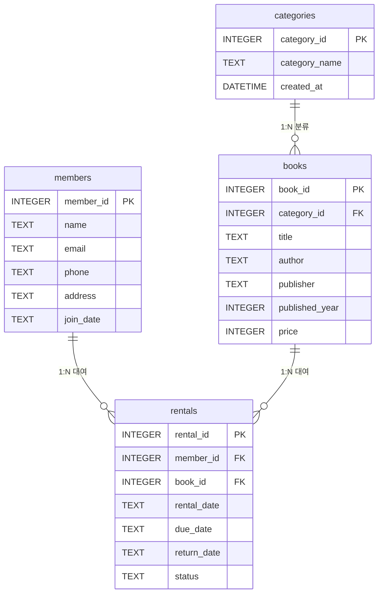

# B6-1 · 디지털 서랍장 — 도서관 스마트 대여/연체 관리 시스템

> **미션**: 정보를 깔끔하게 정리하는 디지털 서랍장 만들기 (SQL/RDBMS 데이터 모델링 + 15대 쿼리)
> **도메인**: 도서관 스마트 대여/연체 관리 시스템 — 4개 테이블, 1:N 관계 3개
> **엔진**: SQLite (파일 기반, 설치 0) · **의존성**: Python 표준 라이브러리만
> **검증**: `python3 verify_sql.py` → **100/100 ALL PASS**
> **개발 방식**: 린 에이전틱 방법론 META_GUIDE v3.5 (내부 작업 지시서 → 무인 생성 → 기계 검증 2단계 교차 감사)

---

## 1. 프로젝트 개요

도서관의 **회원·도서·분류·대여 기록**을 관계형 모델로 설계하고, 데이터 무결성이 실제로 강제되는 스키마와 45행 이상의 한국어 시드 데이터, 그리고 기본 조회부터 조인·집계·서브쿼리·수정/삭제까지 전 범주를 다루는 **15대 쿼리**를 순수 표준 SQL로 납품한다.

- 백엔드 프레임워크·API·UI·뷰·프로시저·트리거를 사용하지 않는다.
- 평가자는 별도 DB 설치 없이 `python3 verify_sql.py` 한 줄로 스키마·시드·무결성·15쿼리·보너스 문서를 **기계 채점**하고, `outputs/query_results.md`에서 15개 쿼리의 **실제 실행 결과**를 확인한다.
- 왜 도서관인가: 4개 테이블이 명확한 1:N 관계 3개를 이루고, 대여·반납·연체 상태가 집계·서브쿼리·UPDATE/DELETE 실습에 가장 자연스럽게 연결되기 때문이다.

---

## 2. 저장소 구조

```text
B6-1/
├── schema.sql                     # DDL: PRAGMA FK, 4개 테이블, 제약조건, 인덱스
├── seed.sql                       # DML: 부모→자식 순서, 4개 테이블 50행 한국어 데이터
├── queries.sql                    # DQL/DML: 15대 쿼리 (Q01~Q15, 카테고리 주석 포함)
├── verify_sql.py                  # 100점 무의존성 기계 채점기 (+ outputs 자동 생성)
├── demo.sh                        # 평가자용 5단계 엔터 진행형 시연 러너
├── README.md                      # 본 문서 (개요·실행·시연·루브릭)
├── SUBMISSION.md                  # 코디세이 제출 서약 및 산출물 링크
├── RTM.md                         # 요구사항 추적성 매트릭스 (38개 항목)
├── ORDER_SHEET.md                 # 내부 작업 지시서 (평가 대상 아님, ADR-018)
├── PROJECT_MANIFEST.json          # 미션·모델·산출물 해시·검증 이력
├── docs/
│   ├── ERD.md                     # Mermaid ERD + 테이블 명세서 + 설계 의도
│   └── bonus/
│       ├── JOIN_VS_SUBQUERY.md    # 보너스1: INNER JOIN vs EXISTS 1:1 대조
│       ├── INTEGRITY_VIOLATION.md # 보너스2: FK 위반 실측(에러 캡처)과 해결
│       └── KPI_REPORT.md          # 보너스3: 경영진 3대 KPI (실측 수치)
├── outputs/
│   └── query_results.md           # 15대 쿼리 실제 실행 결과 (자동 생성)
└── pipeline/
    ├── generate.py                # 무인 생성 파이프라인 (ORDER_SHEET → API → 파일)
    └── runs/*.json                # 실행 메타데이터 (모델·토큰·지연)
```

---

## 3. 데이터 모델 (ERD 요약)



전체 컬럼 명세·제약조건·정규화 근거는 **[docs/ERD.md](docs/ERD.md)** 참조.

| 테이블 | 역할 | PK | FK | 핵심 제약 |
|---|---|---|---|---|
| `categories` | 도서 분류 (부모) | `category_id` | — | `category_name` NOT NULL UNIQUE |
| `members` | 도서관 회원 (부모) | `member_id` | — | `email` NOT NULL UNIQUE, `name`·`phone`·`join_date` NOT NULL |
| `books` | 도서 목록 (자식) | `book_id` | `category_id → categories` | `price >= 0` CHECK, `title`·`author` NOT NULL |
| `rentals` | 대여 기록 (자식) | `rental_id` | `member_id → members`, `book_id → books` | `status IN ('RENTED','RETURNED','OVERDUE')`, `return_date` NULL 허용 |

- FK 의존성은 **위상정렬** 순서(categories/members ➔ books ➔ rentals)로 생성·삽입한다.
- `rentals(rental_date)`에 인덱스 `idx_rentals_date`를 둔다 — 기간 범위 조회와 `strftime` 월별 집계의 전체 스캔을 피하기 위해서다.
- 필수 컬럼 외에 `members.address`, `books.publisher`를 도메인 확장 컬럼으로 두었다(제약조건은 필수 컬럼에 모두 적용).

---

## 4. 실행 방법 (설치 0)

### 요구 사항

- Python 3.9 이상 (표준 라이브러리 `sqlite3` 포함). 외부 패키지 설치 없음.
- SQLite CLI는 필요 없다 — 모든 실행이 Python으로 이루어진다.

### 4-1. 100점 기계 채점 (가장 빠른 확인)

```bash
python3 verify_sql.py
```

기대 출력(끝부분):

```text
✔ [PASS] 7대 필수 산출물 파일 전수 존재 확인 (+20점)
✔ [PASS] 스키마 생성 및 외래키 활성화 확인 (4개 테이블, FK 3개) (+20점)
✔ [PASS] 4개 테이블 각 10행 이상 시드 적재 확인 (... / 총 50행) (+20점)
✔ [PASS] 유령 외래키(FK) 삽입 시 IntegrityError 정상 차단 확인 (+10점)
✔ [PASS] 15대 핵심 쿼리 전수 실행 성공 및 결과 리포트 자동 추출 (+20점)
✔ [PASS] 3대 보너스 문서 심층 작성 확인 (+10점)
 🎉 [100점 만점 ALL PASS] 디지털 서랍장 미션 최종 점수: 100/100점
```

이 실행은 `outputs/query_results.md`를 **매번 결정적으로 재생성**하므로, 두 번 실행해도 Git 워킹 트리가 더러워지지 않는다.

### 4-2. 5단계 시연 러너

```bash
bash demo.sh                  # 엔터를 누르며 한 단계씩
bash demo.sh --non-interactive  # 무인 스모크 테스트 (CI용, exit 0)
```

### 4-3. 직접 DB를 만들어 확인하려면

```bash
python3 - <<'PY'
import sqlite3
conn = sqlite3.connect("library.db")
conn.executescript(open("schema.sql", encoding="utf-8").read())
conn.executescript(open("seed.sql", encoding="utf-8").read())
print(conn.execute("SELECT COUNT(*) FROM rentals;").fetchone())
PY
# 정리
rm -f library.db
```

---

## 5. 15대 쿼리 카테고리 매핑

| 구분 | 쿼리 | 요구 기법 | 결과 행 |
|---|---|---|---|
| 기본 조회 4 | Q01 카테고리별 가격 내림차순 | `WHERE` + `ORDER BY DESC` | 2 |
| | Q02 연체 대여 건 | `WHERE status='OVERDUE'` | 4 |
| | Q03 최근 가입 회원 5명 | `ORDER BY` + `LIMIT` | 5 |
| | Q04 2020년 이후 & 2만원 이상 | 다중 조건 `AND` | 2 |
| 조인 4 | Q05 도서 + 카테고리 | `INNER JOIN` | 13 |
| | Q06 대여 중 회원·도서·반납예정일 | 다중 `INNER JOIN` (3테이블) | 4 |
| | Q07 대여 이력 없는 도서 | `LEFT JOIN` + `IS NULL` | 2 |
| | Q08 회원별 대여 횟수(0회 포함) | `LEFT JOIN` + `COUNT` + `GROUP BY` | 12 |
| 집계 3 | Q09 카테고리별 권수·평균가 | `COUNT`, `AVG`, `GROUP BY` | 10 |
| | Q10 회원별 연체 건수 | `GROUP BY` + `HAVING` | 4 |
| | Q11 월별 대여 추이 | `strftime` + `GROUP BY` | 9 |
| 서브쿼리 2 | Q12 평균가 초과 도서 | 비상관 서브쿼리 | 5 |
| | Q13 회원별 최근 대여일 | SELECT절 상관 서브쿼리 | 12 |
| 수정·삭제 2 | Q14 기한 경과 미반납 → OVERDUE | `UPDATE` (1행) | 1행 영향 |
| | Q15 탈퇴 대기 회원 테스트 대여 삭제 | `DELETE` + 서브쿼리 (1행) | 1행 영향 |

15개 쿼리의 전문과 실제 출력 표는 **[outputs/query_results.md](outputs/query_results.md)** 에 있다.

---

## 6. 시드 데이터

| 테이블 | 행 수 | 내용 |
|---|---|---|
| `categories` | 10 | 소설, 자기계발, 역사, 과학, 컴퓨터, 경제경영, 철학, 예술, 어린이, 여행 |
| `members` | 12 | 한국어 이름·이메일·전화·주소·가입일 (2021~2025) |
| `books` | 13 | 국내외 도서 13권 (저자·출판사·출판연도·가격) |
| `rentals` | 15 | RETURNED 7 · OVERDUE 4 · RENTED 4, 복수 대여 회원 4명 |
| **합계** | **50** | 요구 최소 45행 충족 |

- 대여일은 2026-01~2026-11에 분포한다. RENTED 중 1건은 반납기한이 이미 지나 Q14의 갱신 대상이 되도록 설계했다.
- 대여 이력이 없는 도서 2권(소크라테스의 변명, 구름빵)과 회원 2명(신현우, 류미나)을 두어 Q07·Q08이 **빈 결과가 아닌 실제 행**을 반환하도록 했다.

---

## 7. 보너스 분석 (필수 반영, ADR-015)

| 문서 | 핵심 질문 | 결론 요약 |
|---|---|---|
| [JOIN_VS_SUBQUERY.md](docs/bonus/JOIN_VS_SUBQUERY.md) | 같은 "대여 이력이 있는 회원"을 JOIN과 EXISTS로 어떻게 다르게 쓰는가 | 결과는 동일(10명). JOIN은 `TEMP B-TREE FOR DISTINCT`, EXISTS는 중복 제거 단계 자체가 없다. 존재 여부만 필요하면 EXISTS, 조인 대상 컬럼이 필요하면 JOIN. |
| [INTEGRITY_VIOLATION.md](docs/bonus/INTEGRITY_VIOLATION.md) | 부모 없는 FK를 넣으면 무슨 일이 일어나는가 | `sqlite3.IntegrityError: FOREIGN KEY constraint failed`, 시드 15행 유지. `PRAGMA foreign_keys`를 끄면 조용히 삽입되어 고아 행이 남는 것을 실측으로 대조. |
| [KPI_REPORT.md](docs/bonus/KPI_REPORT.md) | 경영진이 봐야 할 3대 지표는 무엇인가 | 월별 대여 회전율(0.077~0.154, 8~9월 0), 최다 대여 도서(2건 4권 공동 1위), 연체율 **26.7%**(15건 중 4건). 각 지표의 SQL·해석·개선 액션 포함. |

---

## 8. 내부 검증 — verify_sql.py 100점 채점 (평가 시연과 분리)

> 이 장은 개발팀 내부 회귀 안전망이다 (ADR-014 원칙 1). 제품 시연은 제9장을 사용한다.

| 블록 | 검사 내용 | 배점 | 실측 |
|---|---|---|---|
| 1 | 7대 필수 산출물 존재 | 20 | PASS |
| 2 | 스키마 실행 · 4테이블 · PK 4 · FK 3 · `email` UNIQUE · `rentals(rental_date)` 인덱스 | 20 | PASS |
| 3 | 4개 테이블 각 10행 이상 · 총 45행 이상 · 상태 3종 · 복수 대여 회원 | 20 | PASS (50행) |
| 4 | 유령 FK INSERT가 `IntegrityError`로 차단 | 10 | PASS |
| 5 | `-- Q01:` ~ `-- Q15:` 15개 전수 실행 + `outputs/query_results.md` 생성 | 20 | PASS |
| 6 | 보너스 문서 3종 분량·존재 | 10 | PASS |
| | **합계** | **100** | **100/100** |

- 쿼리 분리는 문자열 리터럴·주석 안의 세미콜론을 존중하는 `sqlite3.complete_statement` 기반이다(단순 `split(';')` 금지).
- Q14(=`UPDATE`)·Q15(=`DELETE`)도 실제로 실행되어 영향 행 수를 리포트에 기록한다.

---

## 9. 동료평가 시연 시나리오 (5단계)

발표자는 아래 3요소(멘트·명령·확인 포인트)를 그대로 사용하거나, `bash demo.sh`로 엔터를 누르며 같은 흐름을 보여줄 수 있다.

### [Step 1] 스키마 — 무결성은 선언에서 시작된다

- **📌 멘탈**: "SQLite는 외래키 검사가 기본 OFF입니다. 그래서 `schema.sql` 첫 줄에서 켭니다."
- **💻 실행**: `head -3 schema.sql && python3 -c "import sqlite3;c=sqlite3.connect(':memory:');c.executescript(open('schema.sql').read());print([r[0] for r in c.execute(\"select name from sqlite_master where type='table' and name not like 'sqlite_%'\")])"`
- **🔍 확인**: `PRAGMA foreign_keys = ON;` / `categories, books, members, rentals` 4개 테이블.

### [Step 2] 시드 — 부모에서 자식으로

- **📌 멘탈**: "부모 없는 자식을 넣으면 실패합니다. 그래서 categories·members → books → rentals 순서로 넣고, 총 50행입니다."
- **💻 실행**: `bash demo.sh` → Step 2 (행 수·상태 분포 자동 출력)
- **🔍 확인**: `categories 10 / members 12 / books 13 / rentals 15`, `OVERDUE 4 · RENTED 4 · RETURNED 7`.

### [Step 3] 쿼리 — 조인과 집계가 실데이터로 답한다

- **📌 멘탈**: "INNER JOIN은 카테고리명을 붙이고, LEFT JOIN은 대여 0회 회원까지 0으로 보여줍니다. strftime으로 월별 추이도 뽑습니다."
- **💻 실행**: `bash demo.sh` → Step 3 (Q05·Q08·Q11 결과 표)
- **🔍 확인**: Q08 12행(0회 회원 포함), Q11 9개월.

### [Step 4] 무결성 — 유령 외래키가 거부되는 순간

- **📌 멘탈**: "없는 회원 999번으로 대여를 넣어 봅니다. DB가 거부하고, 행 수는 15 그대로입니다."
- **💻 실행**: `bash demo.sh` → Step 4
- **🔍 확인**: `sqlite3.IntegrityError: FOREIGN KEY constraint failed`, `rentals 행 수: 15 → 15`.

### [Step 5] 채점 — 100점의 근거

- **📌 멘탈**: "산출물·스키마·시드·무결성·15쿼리·보너스 문서를 6개 블록으로 기계 채점합니다."
- **💻 실행**: `python3 verify_sql.py`
- **🔍 확인**: `🎉 [100점 만점 ALL PASS] ... 100/100점`, Exit Code 0.

---

## 10. 루브릭 충족 체크리스트

| 평가 항목 | 요구 | 충족 증거 | 확인 |
|---|---|---|---|
| 테이블 4개 | 4개 테이블 설계 | `schema.sql` — categories/members/books/rentals | ✅ |
| 1:N 관계 3개 | FK 3개 | `books.category_id`, `rentals.member_id`, `rentals.book_id` | ✅ |
| PK·제약조건 | PK, NOT NULL, UNIQUE, CHECK | PK 4 · NOT NULL 17 · UNIQUE 2 · CHECK 2 | ✅ |
| 인덱스 | `rentals(rental_date)` + 사유 | `idx_rentals_date`, 주석 1줄 | ✅ |
| 시드 10행 이상 | 테이블당 10행 이상 | 10/12/13/15 = 50행 | ✅ |
| 15대 쿼리 | 기본4·조인4·집계3·서브쿼리2·수정삭제2 | `queries.sql` Q01~Q15 | ✅ |
| 실행 결과 | 결과 캡처 | `outputs/query_results.md` | ✅ |
| ERD | 다이어그램 | `docs/ERD.md` Mermaid | ✅ |
| 보너스 3종 | JOIN 비교·정합성·KPI | `docs/bonus/` 3문서 | ✅ |
| 재현성 | 원클릭 검증 | `verify_sql.py`, `demo.sh` | ✅ |

---

## 11. 무인 생성 파이프라인과 거버넌스 (개발 이력)

- **ORDER_SHEET.md**는 평가 대상이 아니라 내부 작업 계약서다(ADR-018). Objective·DoD 7개·RTM 38항목·시연 검증 명령을 담는다.
- `pipeline/generate.py`는 Order Sheet와 실제 `schema.sql`을 코디세이 Public API(`claude-sonnet-4`, 실패 시 `gpt-5.4-mini`/`gpt-5.4` 대체)에 주입해 산출물을 만들고, `pipeline/runs/*.json`에 모델·토큰·지연을 기록한다. API 키는 **환경변수로만** 받는다(하드코딩 금지, ADR-016).
- 생성물은 그대로 납품하지 않았다. 기계 채점 1차 실행에서 컬럼명 불일치·해석 수치 오류를 찾아 **핀셋 보정**(Level 1)하고, 보너스 문서의 실행계획·에러 출력은 실제 실행값으로 교체했다.
- `PROJECT_MANIFEST.json`이 미션·모델·산출물 SHA-256·검증 결과를 한 파일에 보존한다.

---

## 12. 한계와 트레이드오프

- **SQLite 전용 문법**: `strftime`, `PRAGMA foreign_keys`는 SQLite 기준이다. PostgreSQL/MySQL로 옮기려면 `to_char`, FK는 DDL에 내장되므로 PRAGMA를 제거해야 한다.
- **상태 이중화**: `rentals.status`는 `return_date`와 `due_date`에서 유도 가능한 값을 저장한다. 조회 성능과 단순성을 위한 의도적 비정규화이며, Q14가 정합을 복구하는 역할을 한다. 실제 운영에서는 트리거·배치로 자동화해야 하지만 미션 규칙상 트리거는 사용하지 않았다.
- **연체 판정 기준일**: Q14는 `DATE('now')`를 쓰므로 실행 시점에 따라 갱신 행 수가 달라진다(현 시드에서는 1행). 재현이 필요한 채점에서는 고정 날짜 파라미터를 쓰는 편이 낫다.
- **표본 규모**: 50행은 학습·검증용이다. 실행계획·인덱스 효과를 일반화하려면 수만 행 규모의 벤치마크가 필요하다.
