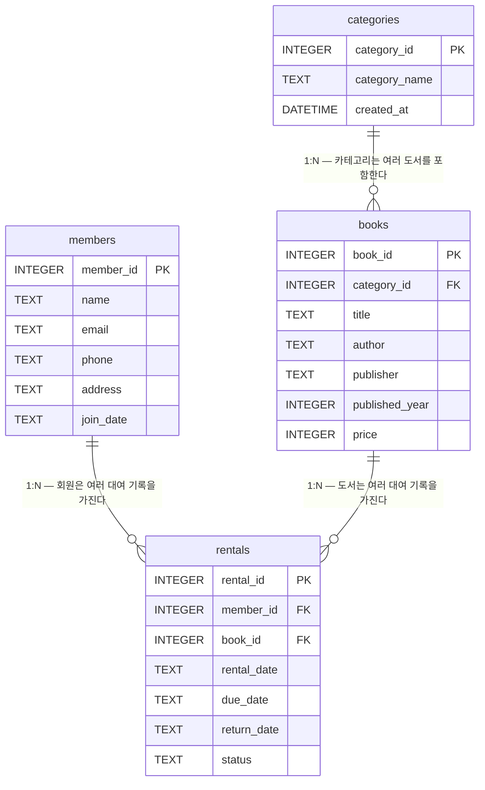

# ERD (Entity Relationship Diagram)

## Mermaid 다이어그램



---

## 테이블 명세서

### 1. categories (카테고리)

| 컬럼명 | 타입 | 제약 | 설명 |
|---|---|---|---|
| category_id | INTEGER | PK, AUTOINCREMENT | 카테고리 고유 식별자 (자동 증가) |
| category_name | TEXT | NOT NULL, UNIQUE | 카테고리명 (중복 불가 — 소설·과학 등) |
| created_at | DATETIME | DEFAULT CURRENT_TIMESTAMP | 카테고리 등록 일시 (기본값: 현재 시각) |

**행 수**: 10행 (소설, 자기계발, 역사, 과학, 컴퓨터, 경제경영, 철학, 예술, 어린이, 여행)

---

### 2. members (회원)

| 컬럼명 | 타입 | 제약 | 설명 |
|---|---|---|---|
| member_id | INTEGER | PK, AUTOINCREMENT | 회원 고유 식별자 (자동 증가) |
| name | TEXT | NOT NULL | 회원 실명 |
| email | TEXT | NOT NULL, UNIQUE | 이메일 주소 (로그인 식별자, 중복 불가) |
| phone | TEXT | NOT NULL | 연락처 전화번호 |
| address | TEXT | NOT NULL | 거주지 주소 |
| join_date | TEXT | NOT NULL | 가입일 (YYYY-MM-DD 형식) |

**행 수**: 12행

---

### 3. books (도서)

| 컬럼명 | 타입 | 제약 | 설명 |
|---|---|---|---|
| book_id | INTEGER | PK, AUTOINCREMENT | 도서 고유 식별자 (자동 증가) |
| category_id | INTEGER | NOT NULL, FK → categories(category_id) | 소속 카테고리 (categories 참조) |
| title | TEXT | NOT NULL | 도서 제목 |
| author | TEXT | NOT NULL | 저자명 |
| publisher | TEXT | NOT NULL | 출판사명 |
| published_year | INTEGER | NOT NULL | 출판 연도 |
| price | INTEGER | NOT NULL, CHECK (price >= 0) | 정가 (음수 불가 — 0원 이상 강제) |

**행 수**: 13행

---

### 4. rentals (대여 기록)

| 컬럼명 | 타입 | 제약 | 설명 |
|---|---|---|---|
| rental_id | INTEGER | PK, AUTOINCREMENT | 대여 기록 고유 식별자 (자동 증가) |
| member_id | INTEGER | NOT NULL, FK → members(member_id) | 대여 회원 (members 참조) |
| book_id | INTEGER | NOT NULL, FK → books(book_id) | 대여 도서 (books 참조) |
| rental_date | TEXT | NOT NULL | 대여 시작일 (YYYY-MM-DD) |
| due_date | TEXT | NOT NULL | 반납 예정일 (YYYY-MM-DD) |
| return_date | TEXT | — (NULL 허용) | 실제 반납일 (미반납 시 NULL) |
| status | TEXT | NOT NULL, CHECK (status IN ('RENTED','RETURNED','OVERDUE')) | 대여 상태 (3가지 값만 허용) |

**인덱스**: `idx_rentals_date ON rentals (rental_date)`
- 대여일 기준 기간 범위 조회 및 월별 대여 추이 집계 성능을 위해 인덱스를 생성한다.

**행 수**: 15행 (RETURNED 7건, OVERDUE 4건, RENTED 4건)

---

## 관계 설명

### 1:N 관계 3개

| 부모 테이블 | 자식 테이블 | 관계 | 의미 |
|---|---|---|---|
| categories | books | 1:N | 하나의 카테고리는 0개 이상의 도서를 포함한다. 도서는 반드시 하나의 카테고리에 속해야 한다. |
| members | rentals | 1:N | 한 명의 회원은 0건 이상의 대여 기록을 가질 수 있다. 대여 기록은 반드시 실존 회원에 연결되어야 한다. |
| books | rentals | 1:N | 하나의 도서는 0건 이상의 대여 기록을 가질 수 있다. 대여 기록은 반드시 실존 도서에 연결되어야 한다. |

---

## 설계 의도

### 정규화 (Normalization)

- **제1정규형(1NF)**: 모든 컬럼은 원자값(Atomic Value)을 가진다. 카테고리명, 회원 이메일 등 반복 그룹이 없다.
- **제2정규형(2NF)**: 단일 컬럼 PK를 사용하므로 부분 함수 종속이 존재하지 않는다.
- **제3정규형(3NF)**: 비키 컬럼 간 이행 종속을 제거했다. 카테고리 정보는 `books`에 중복 저장하지 않고 `category_id` FK로만 참조한다. 회원 정보는 `rentals`에 중복 저장하지 않고 `member_id` FK로만 참조한다.

### 위상정렬 (Topological Sort) — DDL·DML 생성 순서

외래키 의존성 그래프를 위상정렬하여 부모 테이블을 자식 테이블보다 먼저 생성·삽입한다. 역순 생성 시 `FOREIGN KEY constraint failed` 오류가 발생하므로 아래 순서를 절대 준수한다.

```
[DDL 생성 순서]
1. categories   (의존 없음 — 루트 노드)
2. members      (의존 없음 — 루트 노드)
3. books        (category_id → categories)
4. rentals      (member_id → members, book_id → books)

[DML 삽입 순서]
1. categories INSERT
2. members INSERT
3. books INSERT
4. rentals INSERT
```

### 인덱스 설계

| 인덱스명 | 대상 컬럼 | 생성 이유 |
|---|---|---|
| idx_rentals_date | rentals.rental_date | 대여일 기준 기간 범위 조회(WHERE rental_date BETWEEN …) 및 월별 대여 추이 집계(strftime + GROUP BY) 시 전체 테이블 스캔을 회피하고 B-Tree 범위 탐색으로 성능을 확보한다. |

### 무결성 제약조건 설계 의도

| 제약 종류 | 적용 위치 | 의도 |
|---|---|---|
| PRIMARY KEY | 전 테이블 | 행 고유성 보장 및 FK 참조 대상 확보 |
| FOREIGN KEY | books.category_id, rentals.member_id, rentals.book_id | 참조 무결성 — 존재하지 않는 부모 행을 자식이 참조하는 고아 레코드(Orphan Record) 방지 |
| NOT NULL | 전 테이블 필수 컬럼 | 핵심 업무 데이터의 누락 방지 |
| UNIQUE | members.email, categories.category_name | 이메일 중복 가입 방지, 카테고리명 중복 등록 방지 |
| CHECK (price >= 0) | books.price | 음수 가격이라는 비즈니스 규칙 위반 데이터 원천 차단 |
| CHECK (status IN (…)) | rentals.status | 허용되지 않은 상태값 삽입 차단 — 열거형(Enum) 효과를 순수 SQL로 구현 |
| DEFAULT CURRENT_TIMESTAMP | categories.created_at | 애플리케이션 레이어 없이 DB 레벨에서 등록 시각 자동 기록 |
| NULL 허용 | rentals.return_date | 미반납 상태(RENTED·OVERDUE)에서 반납일이 존재하지 않는 현실을 모델에 반영 |
